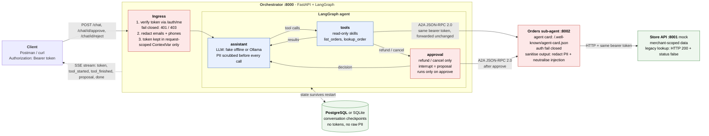

# ShopHub Support Assistant

A multi-tenant, tool-using AI support agent for ShopHub merchant staff. Built with FastAPI, LangGraph, Google Agent2Agent (A2A) protocol, JSON-RPC 2.0, and PostgreSQL.

## Architecture



The same diagram lives in [`docs/architecture.mmd`](docs/architecture.mmd).

## Quick Start with Docker (R10)

Start the database, mock store API, orders sub-agent, and orchestrator with one command:

```bash
docker compose up --build
```

Services exposed:
- **Orchestrator**: `http://localhost:8000` (`/chat`, `/health`)
- **Orders Sub-Agent**: `http://localhost:8002` (`/.well-known/agent-card.json`, `/.well-known/agent.json`, `/rpc`, `/health`)
- **Store API**: `http://localhost:8001` (`/orders`, `/auth/me`, `/health`)
- **Postgres**: `localhost:5432` (`shophub/shophub`)

## Running Locally

### 1. Install Dependencies

Using `uv` :
```bash
uv sync
```


### 2. Start Services Locally

In separate terminal windows:
```bash
# Terminal 1: Store API
uvicorn store_api.main:app --port 8001

# Terminal 2: Orders Sub-Agent
STORE_API_URL=http://127.0.0.1:8001 ORDERS_AGENT_PUBLIC_URL=http://127.0.0.1:8002 uvicorn orders_agent.main:app --port 8002

# Terminal 3: Orchestrator (defaults to offline FakeChatModel)
STORE_API_URL=http://127.0.0.1:8001 ORDERS_AGENT_URL=http://127.0.0.1:8002 uvicorn main:app --port 8000
```

## LLM Configuration

The project supports offline fake LLM mode (default, no API keys or internet needed) and local Ollama:

- **Fake LLM (default, offline)**:
  ```bash
  LLM_PROVIDER=fake uvicorn main:app --port 8000
  ```
- **Ollama**:
  ```bash
  LLM_PROVIDER=ollama LLM_MODEL=gemma3:latest OLLAMA_BASE_URL=http://localhost:11434 uvicorn main:app --port 8000
  ```

## Logging

Every service (orchestrator, orders-agent, store-api) logs to stdout through `common/logging_config.py`.

| Env var      | Default | Meaning                                  |
|--------------|---------|------------------------------------------|
| `LOG_LEVEL`  | `INFO`  | `DEBUG`, `INFO`, `WARNING`, `ERROR`      |
| `LOG_FORMAT` | `text`  | `text` or `json` (one JSON object/line)  |

Each line carries the service name and a per-request id. What is logged: auth decisions
(including fail-closed rejections), chat turns, how many e-mails/phones were redacted (counts only),
tool start/finish, proposals raised / approved / rejected, mutations, tenant-mismatch alarms, errors.

What is **never** logged: bearer tokens, e-mail addresses, phone numbers, message text. Users appear as a
short hash (`user=ad44a262`), tenants as their merchant id. A filter on every handler also scrubs
PII and tokens from any record (including third-party libraries and tracebacks) as a safety net.
Note: `LOG_LEVEL=DEBUG` turns on third-party debug logs (e.g. aiosqlite); they are scrubbed too, but
keep production at `INFO`.

```bash
docker compose logs -f orchestrator orders-agent store-api
LOG_FORMAT=json LOG_LEVEL=DEBUG docker compose up
```

## Credentials and PII handling

* **Token lifetime.** The caller's bearer token is held only in a request-scoped `ContextVar`. The A2A
  client reads it through `RequestScopedCredentials`, which has no storage, and the variable is reset when
  the turn ends. It is never put in graph state, the checkpoint database, an in-memory cache or a log.
* **PII redaction** (`common/guardrails.py`) runs on the user's message at ingress, on every tool result, and again
  just before each model call. It catches plain, spaced, letter-spaced, `[at]/(at)/[dot]` and full-width e-mails, and
  international / bracketed / unseparated phone numbers, while leaving order ids, totals and ISO dates alone.

## Running Tests (R8)

All tests run fully offline without any API keys or network access:

```bash
pytest -v
```

## Running the Evaluation Harness (R9)

Runs 7 scripted multi-turn end-to-end evaluation cases reporting per-case PASS/FAIL results:

```bash
python eval.py
```

To run against a local Ollama model:
```bash
LLM_PROVIDER=ollama python eval.py
```

### Evaluation Cases Covered:
1. **C1**: Tool routing and execution (`lookup_order` returns correct status)
2. **C2**: Filtered listing (`list_orders` excludes foreign merchants and unshipped orders)
3. **C3**: Human-in-the-loop proposal generation and approval execution
4. **C4**: Adversarial prompt injection in customer notes neutralised
5. **C5**: Multi-tenant isolation (cross-merchant lookups refused)
6. **C6**: Fail-closed auth (valid token with null merchant rejected with 403)
7. **C7**: Human-in-the-loop proposal rejection (no mutations made)

## Interacting with the Streaming Chat (R6)

The chat API streams **Server-Sent Events** (SSE). Use `curl -N` (no buffering) or Postman; no extra client script is needed.
Start the stack first (`docker compose up --build`, or the three `uvicorn` commands above).

**Dev tokens** (from the mock store API):

| Token              | Merchant          | Use                          |
|--------------------|-------------------|------------------------------|
| `tok-acme-staff`   | `acme` (orders 1001-1008)   | normal user        |
| `tok-zenith-staff` | `zenith` (orders 2001-2007) | second tenant      |
| `tok-orphan`       | none              | must be rejected (403)       |

Optional shell variables, used by every command below:

```bash
BASE=http://localhost:8000
TOKEN=tok-acme-staff
```

### 1. Ask a question (streams tool events, then tokens)

```bash
curl -N -X POST $BASE/chat \
  -H "Authorization: Bearer $TOKEN" \
  -H "Content-Type: application/json" \
  -d '{"message": "What is the status of order 1001?", "conversation_id": "demo"}'
```

Response (SSE): `conversation` -> `tool_started` -> `tool_finished` -> many `token` events (the answer, word by word) -> `done`.

### 2. Ask for a refund (creates a proposal; nothing executes yet)

```bash
curl -N -X POST $BASE/chat \
  -H "Authorization: Bearer $TOKEN" \
  -H "Content-Type: application/json" \
  -d '{"message": "Refund order 1001", "conversation_id": "demo2"}'
```

The stream ends with a `proposal` event (order, merchant, current -> new status, amount) and `done` with `"pending_approval": true`.
While a proposal is pending, a new `/chat` on that conversation returns **409**.

### 3. Approve (executes the refund)

```bash
curl -N -X POST $BASE/chat/demo2/approve \
  -H "Authorization: Bearer $TOKEN" \
  -H "Content-Type: application/json" \
  -d '{"order_id": 1001}'
```

`order_id` is optional; if given it must match the pending proposal (otherwise 409).

### 4. Reject instead (no change is made)

```bash
curl -N -X POST $BASE/chat -H "Authorization: Bearer $TOKEN" -H "Content-Type: application/json" \
  -d '{"message": "Cancel order 1005", "conversation_id": "demo3"}'

curl -N -X POST $BASE/chat/demo3/reject -H "Authorization: Bearer $TOKEN"
```

### 5. Security checks

```bash
# Another merchant's order -> "couldn't find that order" (tenant isolation)
curl -N -X POST $BASE/chat -H "Authorization: Bearer $TOKEN" -H "Content-Type: application/json" \
  -d '{"message": "show order 2001"}'

# Prompt injection in a customer note (order 1003) -> note is withheld, no proposal
curl -N -X POST $BASE/chat -H "Authorization: Bearer $TOKEN" -H "Content-Type: application/json" \
  -d '{"message": "show order 1003"}'

# Valid token without a merchant -> 403 (fail closed)
curl -i -X POST $BASE/chat -H "Authorization: Bearer tok-orphan" -H "Content-Type: application/json" \
  -d '{"message": "list orders"}'

# No token -> 401
curl -i -X POST $BASE/chat -H "Content-Type: application/json" -d '{"message": "hi"}'
```

### 6. Persistence across a restart (R7)

```bash
curl -N -X POST $BASE/chat -H "Authorization: Bearer $TOKEN" -H "Content-Type: application/json" \
  -d '{"message": "Refund order 1001", "conversation_id": "restart-demo"}'   # proposal raised

docker compose restart orchestrator                                         # state is in PostgreSQL

curl -N -X POST $BASE/chat/restart-demo/approve -H "Authorization: Bearer $TOKEN"   # still approvable
```

### 7. Sub-agent endpoints (optional)

```bash
curl http://localhost:8002/.well-known/agent-card.json      # A2A agent card (discovery)
curl http://localhost:8001/health                           # store API
```

### Using Postman

1. **Import -> Raw text**, paste any `curl` command above (replace `$BASE` and `$TOKEN` with real values), then **Continue -> Import**.
2. Check that the `Authorization` header (`Bearer tok-acme-staff`) and the JSON body were imported.
3. Click **Send**. Postman shows the SSE events as they arrive in the response panel (if a response looks empty
   until it finishes, update Postman or use `curl -N`).
4. For the approve / reject calls, keep the same `conversation_id` in the URL path as in the chat request.
